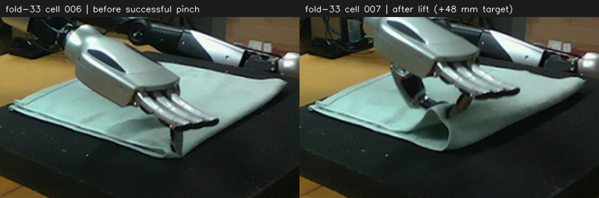

# 简单双臂捻布与搬放示范

参考 fold-33 的成功捻布，简化为夹起后在 `x <= -0.47 m` 区域内搬放，不要求到达原示范的远端对折点。
公共 task 系为右臂基座，位置用 m。**全程保持各侧初始朝向（yaw=0），不调整 yaw；两侧所有目标 TCP 的 X 均不大于 -0.47 m。**
双臂一起移动用 `move_both()`，姿态分别用 `top_down_pose(..., arm=...)` 构造；抓放点按现场选择，两侧路径保持空间分离。

- 对边看指尖是否接触布边，而非只看 TCP 投影。fold-33 的有效修正主要是下降，目标 Z 从 0.018 降至 0.012；指尖悬空时小幅调低，不能只反复调整 X/Y。
- **每次 `close_gripper(arm=a)` 正常返回后，紧接着 `observe()` 保存闭合快照，再执行该侧抬升；单臂重抓也遵循此顺序，不得省略或挪到抬升之后。** 代码中的闭合之后拍摄的图片能够更容易反应闭合之后的情况，从而据此更好调整。
- 放置点必须在 Cell 4 高位观察返回后重新选择，满足 X≤-0.47 m；例如右侧可参考 `[-0.480, -0.067]`。
- 本例在高位增加一次观察，用于判断布料状态及放置落点（因为在拿起布料后布料会移动，从而导致之前估计的落点不准确）；确定后连续搬运、放置、松手、撤离，途中不例行观察，最终撤离后再看结果。、



原始 RGB 程序裁剪放大：cell 006 / 007；闭合前观察实测右 TCP≈`[-0.71963, -0.09012, 0.01162]`。

### Cell 1：双侧预抓手型、状态与初始观察

```python
arms = ("left", "right")

def reached(result):
    print(result)
    assert result.reached, result

def move_pair(xyz, mode="L"):
    assert all(float(xyz[a][0]) <= -0.47 for a in arms), "目标 TCP X 不应大于 -0.47 m"
    pose = {a: robo.top_down_pose(xyz[a], yaw=0.0, arm=a) for a in arms}
    result = robo.move_both(left=pose["left"], right=pose["right"], mode=mode, wait=True)
    for a in arms:
        reached(result[a])

print(robo.state())
for a in arms:
    print(a, robo.gripper_replay_start(arm=a))
obs = robo.observe()
robo.show(obs)
```

### Cell 2：分别选点，到布角上方再下降，观察对边

收到 Cell 1 图像后，在本 cell 开头定义下列字典，**每项都要包含** `left`**、**`right`。
左侧 TCP 为单独标定的预抓手型食指指尖参考点，与历史右侧拈布点不同，须分别确定高度。

| 变量 | 每侧内容 | 右侧参考值，须按现场调整 |
| --- | --- | --- |
| `grasp` | 抓取 XYZ | `[-0.720, -0.090, 0.012]` |
| `hover_z` | 接近高度 | `0.066` |

此时只确定抓取与接近参数；`place_xy`、`place_z`、`retract_z` 留到 Cell 4 的新图返回后再确定。

```python
# 先按当前观察填写上述左右字典；不要照搬历史坐标。
s = robo.state()
p = {a: np.array(s["arms"][a]["tcp"])[:3, 3].copy() for a in arms}
hover = {a: max(float(p[a][2]), hover_z[a]) for a in arms}
move_pair({a: [p[a][0], p[a][1], hover[a]] for a in arms}, mode="J")
move_pair({a: [grasp[a][0], grasp[a][1], hover[a]] for a in arms})
move_pair(grasp, mode="J")
obs = robo.observe()
robo.show(obs)
```

### Cell 3：逐侧闭合留图并小抬，双侧抬升后统一返回图片

两张图分别为左右侧闭合后、该侧抬升前的快照，按 `arms` 顺序在本 cell 结束时一起返回。
代码中的闭合之后拍摄的图片能够更容易反应闭合之后的情况，从而据此更好调整。

```python
s = robo.state()
preclose = {a: np.array(s["arms"][a]["tcp"])[:3, 3].copy() for a in arms}
close_obs = {}
for a in arms:
    print(a, robo.close_gripper(arm=a))
    close_obs[a] = robo.observe()
    reached(robo.move_L(robo.top_down_pose(preclose[a] + [0, 0, 0.010],
                                         yaw=0.0, arm=a), arm=a))
move_pair({a: preclose[a] + [0, 0, 0.048] for a in arms})
for a in arms:
    robo.show(close_obs[a])
```

### Cell 4：继续抬升并观察

原 cell 010 将抬升、翻折搬运和放置写在一起。这里先只执行抬升：原示范高度为 0.120 m，
若当前已更高则不下降。**本 cell 必须在 `show()` 后返回，等待 agent 看到抬升后的新图。**

```python
s = robo.state()
p = {a: np.array(s["arms"][a]["tcp"])[:3, 3].copy() for a in arms}
lift_z = {a: max(float(p[a][2]), 0.120) for a in arms}
move_pair({a: [p[a][0], p[a][1], lift_z[a]] for a in arms})
obs = robo.observe()
robo.show(obs)
```

### Cell 5：根据抬升后的图像选放置点，再连续搬运、放置和撤离

收到 Cell 4 图像后，先判断两侧是否夹住、毛巾的悬起形状以及对应角的位置，再分别定义
`place_xy`、`place_z`、`retract_z` 的左右字典。**不能沿用抓布前预先固定的落点，也不能与 Cell 4 合并执行。**
原 cell 010 使用 X=-0.590 的中间点、X=-0.480 的放置点；Y 为左 -0.347、右 -0.063，
放置 Z=0.025、撤离 Z=0.130。这里只作为历史参考，当前落点必须依据新图调整且 X≤-0.47 m。

```python
# 先依据 Cell 4 返回的新图填写 place_xy、place_z、retract_z。
fold_y = {a: place_xy[a][1] for a in arms}
move_pair({a: [-0.590, fold_y[a], lift_z[a]] for a in arms})
move_pair({a: [*place_xy[a], max(place_z[a] + 0.050, 0.075)] for a in arms})
move_pair({a: [*place_xy[a], place_z[a]] for a in arms})
for a in arms:
    print(a, robo.open_gripper(arm=a))
move_pair({a: [place_xy[a][0] - 0.010, place_xy[a][1], retract_z[a]] for a in arms})
obs = robo.observe()
robo.show(obs)
```

检查放置结果后继续本轮任务流程。原始参考：`data/agent_runs/bi_fold-013/cells/010.py`、`010.json`。
