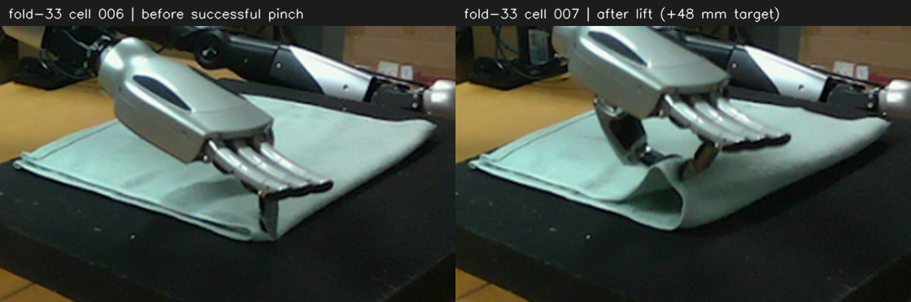
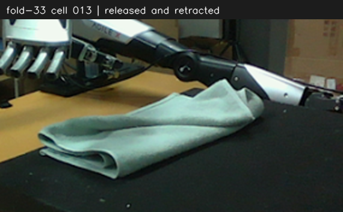

# fold-33：捻布与粗略对折经验（双臂接口版）

fold-33 是右臂成功夹起、搬运、松手并撤离的历史示范，结果仍有卷边、褶皱和错位。
以下 4 个参考 cell 已适配双臂接口，尚未实机验证；历史照片与坐标均来自右臂。
公共 task 系为右臂基座，位置用 m；yaw 是相对**各侧自身初始朝向**绕 task +Z 的增量，单位 rad。
**双臂一起移动用 `move_both()`；yaw 增量左右取反：右侧 -0.70、左侧 +0.70。**
各侧 `top_down_pose(..., arm=...)` 使用本侧参考姿态，不能把右侧位姿矩阵直接交给左臂。
镜像 yaw 用于减少两手向内相碰的风险，仍须让两侧点位和路径保持空间分离；接口不做碰撞检测。

- 对边看指尖是否接触布边，而非只看 TCP 投影。fold-33 的有效修正主要是下降，目标 Z 从 0.018 降至 0.012；指尖悬空时小幅调低，不能只反复调整 X/Y。
- 每侧闭合后立即先抬 10 mm，再到相对该侧闭合前累计 48 mm；图像确认两侧夹布后才搬运。
- 原右臂在 X=-0.560 处从 yaw=0 调到 -0.70，J4 由约 1.754 降至 1.289 rad，再保持朝向搬运。
  左侧采用 +0.70 的镜像增量，但抓放点、高度及换朝向位置须按自己的标定和现场选择，不能直接镜像历史 X/Y。
- 确认夹布后连续搬运、放置、松手、撤离，中间不例行观察，最终撤离后再看结果。



原始 RGB 程序裁剪放大：cell 006 / 007；闭合前观察实测右 TCP≈`[-0.71963, -0.09012, 0.01162]`。

### Cell 1：双侧预抓手型、状态与初始观察

```python
arms = ("left", "right")

def reached(result):
    print(result)
    assert result.reached, result

def move_pair(xyz, mode="L", yaw_right=0.0):
    yaw = {"right": yaw_right, "left": -yaw_right}
    pose = {a: robo.top_down_pose(xyz[a], yaw=yaw[a], arm=a) for a in arms}
    result = robo.move_both(left=pose["left"], right=pose["right"], mode=mode, wait=True)
    for a in arms:
        reached(result[a])

print(robo.state())
for a in arms:
    print(a, robo.gripper_replay_start(arm=a))
obs = robo.observe()
robo.show(obs)
```

### Cell 2：分别选点，到布角上方再下降，观察对边

收到 Cell 1 图像后，在本 cell 开头定义下列字典，**每项都要包含 `left`、`right`**。
左侧 TCP 为单独标定的预抓手型食指指尖参考点，与历史右侧拈布点不同，须分别确定高度。

| 变量 | 每侧内容 | 原右臂示范值，仅作参考 |
| --- | --- | --- |
| `grasp` | 抓取 XYZ | `[-0.720, -0.090, 0.012]` |
| `via_xy` | 换朝向点 XY、后续中间点 XY | `[[-0.560, -0.080], [-0.480, -0.074]]` |
| `place_xy` | 放置 XY | `[-0.423, -0.067]` |
| `hover_z` / `place_z` / `retract_z` | 接近、放置、撤离高度 | `0.066` / `0.028` / `0.078` |

```python
# 先按当前观察填写上述左右字典；不要照搬历史坐标。
s = robo.state()
p = {a: np.array(s["arms"][a]["tcp"])[:3, 3].copy() for a in arms}
hover = {a: max(float(p[a][2]), hover_z[a]) for a in arms}
move_pair({a: [p[a][0], p[a][1], hover[a]] for a in arms}, mode="J")
move_pair({a: [grasp[a][0], grasp[a][1], hover[a]] for a in arms})
move_pair(grasp, mode="J")
obs = robo.observe()
robo.show(obs)
```

### Cell 3：逐侧闭合后立即小抬，再双侧抬升并确认夹布

```python
s = robo.state()
preclose = {a: np.array(s["arms"][a]["tcp"])[:3, 3].copy() for a in arms}
for a in arms:
    print(a, robo.close_gripper(arm=a))
    reached(robo.move_J(robo.top_down_pose(preclose[a] + [0, 0, 0.010],
                                         yaw=0.0, arm=a), arm=a))
move_pair({a: preclose[a] + [0, 0, 0.048] for a in arms}, mode="J")
obs = robo.observe()
robo.show(obs)
```

### Cell 4：镜像 yaw、分段搬运、放置撤离，最后观察

```python
s = robo.state()
carry_z = {a: float(np.array(s["arms"][a]["tcp"])[2, 3]) for a in arms}
move_pair({a: [*via_xy[a][0], carry_z[a]] for a in arms})
s = robo.state()
p = {a: np.array(s["arms"][a]["tcp"])[:3, 3].copy() for a in arms}
move_pair(p, mode="J", yaw_right=-0.70)  # 左 +0.70，右 -0.70
move_pair({a: [*via_xy[a][1], carry_z[a]] for a in arms}, yaw_right=-0.70)
move_pair({a: [*place_xy[a], carry_z[a]] for a in arms}, yaw_right=-0.70)
move_pair({a: [*place_xy[a], place_z[a]] for a in arms}, mode="J", yaw_right=-0.70)
for a in arms:
    print(a, robo.open_gripper(arm=a))
move_pair({a: [*place_xy[a], retract_z[a]] for a in arms}, mode="J", yaw_right=-0.70)
obs = robo.observe()
robo.show(obs)
s = robo.state()
for a in arms:
    print(a, s["arms"][a]["arm_status"])
print(s["hold_confirmed"], s["quiescent"], s["fault"])
```



原示范最终右 TCP≈`[-0.42329, -0.06775, 0.07795]`，NORMAL、idle、保持已确认、fault为空。
依据本轮最终图像提交 MCP `finish`；不把到位或手指反馈单独当成对折成功。
原始证据：`data/agent_runs/fold-33/cells/006–013`、`result.json`。
