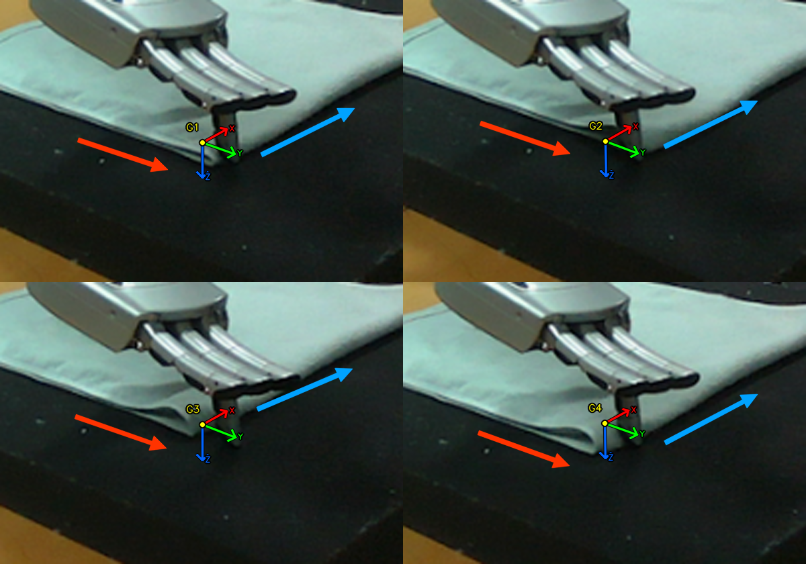

先调用 robo.gripper_replay_start()，使拇指和食指到示范 CSV 首帧的预抓手型，再选择虚拟 TCP 目标并移动，结合实际手指与两条相邻布边的位置关系微调。

左上 G1、右上 G2、左下 G3 均空抓；右下 G4 抬升后夹起布角。“成功”仅指抓起布角，不代表完成对折。

图中黄色点为虚拟 TCP（拇指、食指闭合接触点）的几何投影，不是打开时的指尖或实际接触区。细红 X、绿 Y、蓝 Z 为 TCP 局部坐标轴，轴长 3 cm，不是 task 坐标轴。粗蓝箭头沿右侧布边指向右上，粗红箭头沿左下侧布边指向右下；它们表示本图的沿边微调方向，不表示移动距离。

拍摄各次最后一张闭合前观察图时，实测关节 FK 得到的 TCP 坐标如下（task 系 XYZ，单位 m；朝向均接近 top_down_pose(..., yaw=0)）：
G1：[-0.70087, -0.05505, 0.01771]
G2：[-0.69154, -0.03804, 0.01384]
G3：[-0.71789, -0.05513, 0.01265]
G4：[-0.70011, -0.07795, 0.01623]
这些是观察时的实测值，不是下发目标；Z 不是手指到布面的间隙，不应直接复制 X/Y。

G1、G2 沿粗蓝箭头方向、G3 沿粗红箭头反方向仅是 fold-31 这张图的调整参考，不是通用移动规则。对边应优先看指尖是否实际接触布边，而非追求某个 TCP 投影落点；不要把 TCP 与食指接触区混为一谈。

fold-33 的补充经验：按操作者对现场图像的判断，首次空抓可沿粗红箭头正向（图像右下）小幅推进，使指尖接触布边；后续成功修正主要来自降低抓取高度（目标 Z 从 0.018 降至 0.012 m）。指尖悬空时应小幅调低，而非只在 X/Y 上反复探索。这是本轮手型与布边关系的经验，不应机械复制坐标。

前三次空抓不能单凭图片归因为“碰不到布料”：各次高度不同，G4 还改为闭合后立即先抬 10 mm、再抬至累计 48 mm。应结合位置、高度及闭合后立即抬升的反馈判断效果。

## L20 经验：被垫子挡住时，抬起即可恢复

fold-35 捻布时，L20 闭合到位超时是因为手指被垫子挡住；此时抬起手，留出闭合空间即可恢复。
