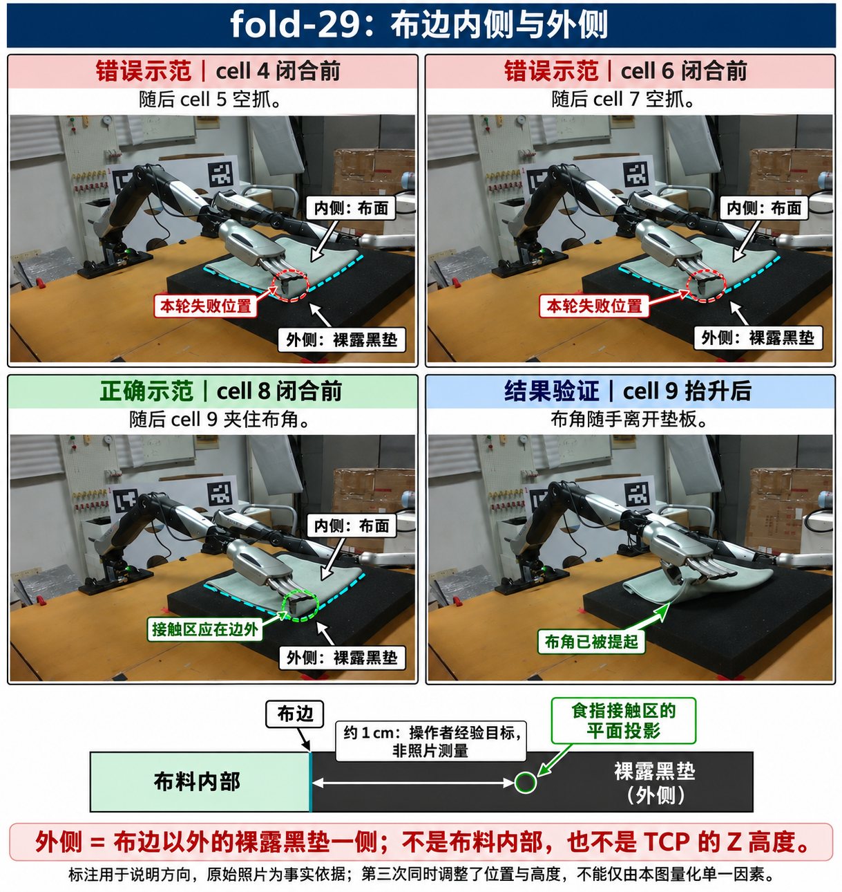

## 核心经验：先用预抓手型对边，再闭合 Pre-grasp alignment

抓布前先调用 **`robo.gripper_replay_start()`**，使拇指和食指到示范 CSV 首帧的预抓手型。
保持这个手型观察、调整机械臂，**让食指实际接触区域在桌面平面上的投影，位于目标布边以外、
裸露黑垫这一侧，距该边约 1 cm，再调用 `robo.close_gripper()`**。
先指认角点旁具体的那一条布边：有布覆盖的一侧是内侧，没有布覆盖的裸露黑垫一侧是外侧。
沿桌面平面、垂直于这条边，从布料内部跨过边界向外约 1 cm；不要把食指接触区放在布面内侧。
约 1 cm 描述食指接触区相对布边的水平距离，不是 TCP 的固定偏移、Z 高度或固定像素数。
食指接触区与虚拟 TCP 不同，不能把前者的位置直接当成 TCP 目标。

- `open_hand()` 是启动时的全手张开；`open_gripper()` 是拇指/食指张开预设；
  `gripper_replay_start()` 是用于视觉比对的预抓手型，三者不能混作同一个状态。
- 四组闭合前照片的手部目标均为 `replay_start`，之后各执行一次 `close_gripper`。
  对边后再切回 `open_gripper` 会改变手指形状，需要重新观察对边，不能沿用原来的判断。
- 预抓手型固定时，先小幅调整 TCP 位置；布边方向不合适时，在有空间的位置调整 yaw，
  再观察食指与布边的关系。四组成功夹布的朝向均接近约定的 `top_down_pose(..., yaw=0)`，
  没有证据表明需要默认修改 roll/pitch 或执行额外旋转。
- TCP 仍是**拇指、食指闭合接触点**；换成预抓手型后不重新定义 TCP。
  打开的指尖、运动中的拇指和手的最低点不等于 TCP 原点，不能靠降低 TCP 到布面来证明贴合。

## 数值经验与适用范围 Numbers and limits

下表是 `photos.json` 的 `pre_close_tcp`：**拍摄闭合前照片时，由实测关节 FK 得到的虚拟 TCP**。
XYZ 单位 m；Z 为便于阅读换成 mm。不是下发目标，也不是相机深度或布面间隙。

| 示范 | 实测 task X / Y（m） | 实测 task Z（mm） |
| --- | --- | --- |
| success-1 | -0.704952 / -0.050007 | 20.711 |
| success-2 | -0.708696 / -0.052555 | 13.457 |
| success-3 | -0.769179 / -0.057252 | 18.199 |
| success-4 | -0.538631 / -0.069837 | 12.628 |

- **抓取高度先验**：四组闭合时 task Z 为 **0.0126–0.0207 m**。可把约 `0.017 m` 作为接近抓取区的参考，随后依据
  预抓手型与布边关系微调。不要复制表中的 X/Y；布料和目标角会改变。

## 手型配置与证据 Hand preset and evidence

启动附件前 8 张图按下表从上到下、每行从左到右排列：success-1 前/后、success-2 前/抬升后、
success-3 前/后、success-4 前/后；第 9 张为下方 fold-29 正误对照。它们是历史示范 Demo images，
当前现场仍需 `observe()` 获取。

`annotated/` 中黄色 G1 原点和红 X / 绿 Y / 蓝 Z 三轴是**闭合前固定 TCP**的几何投影，
轴长 3 cm；同一参考会画到本轮所有照片上，不会跟随闭合后手指或抬升后的 TCP 移动，
也不处理遮挡。它不是人工描出的布边或实际接触点。抓取几何要结合手指、布边本身来看。

| 离线证据 | 闭合前 / 闭合后图像 | 数值与结果 |
| --- | --- | --- |
| success-1 | [before](../data/grasp_debug/success-1/annotated/001_G1_before.png) / [after](../data/grasp_debug/success-1/annotated/002_G1_after.png) | [TCP 标注](../data/grasp_debug/success-1/photos.json)，[抬升反馈](../data/grasp_debug/success-1/cells/026.json) |
| success-2 | [before](../data/grasp_debug/success-2/annotated/002_G1_before.png) / [抬升后](../data/grasp_debug/success-2/annotated/004_photo.png) | [TCP 标注](../data/grasp_debug/success-2/photos.json)，[抬升反馈](../data/grasp_debug/success-2/cells/042.json) |
| success-3 | [before](../data/grasp_debug/success-3/annotated/002_G1_before.png) / [after](../data/grasp_debug/success-3/annotated/003_G1_after.png) | [TCP 标注](../data/grasp_debug/success-3/photos.json)，[后续故障](../data/grasp_debug/success-3/result.json) |
| success-4 | [before](../data/grasp_debug/success-4/annotated/001_G1_before.png) / [after](../data/grasp_debug/success-4/annotated/002_G1_after.png) | [TCP 标注](../data/grasp_debug/success-4/photos.json)，[抬升反馈](../data/grasp_debug/success-4/cells/014.json) |

### fold-29 正误对照：外侧是裸露黑垫 Outside means the uncovered pad

- 错误示范：cell 4、6 的抓前位置，随后 cell 5、7 都空抓；cell 6 代码还明确打印了“布边内侧微调”。
- 正确示范：cell 8 的抓前位置，cell 9 抬升后布角随手离开垫板；第三次同时调整了位置与高度，
  不能只凭这次对照断言失败完全由某一个因素造成。
- 图为 imagegen 辅助标注，细线与圈用于说明边界和方向，不是精确接触点、分割标注或距离测量。
  下方的 1 cm 是操作者提出的经验目标；判断实验细节时以原图为准。
  原始记录位于 `data/agent_runs/fold-29/cells/004.json`、`006.json`、`008.json`、`009.json`。

