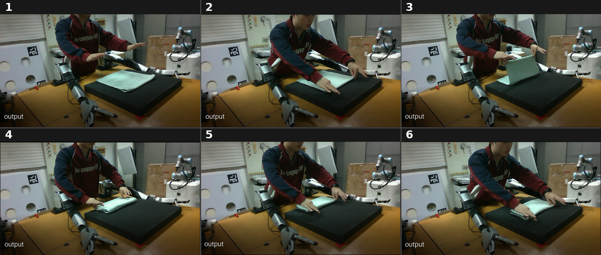

# 任务：将毛巾对折一次，再搬到垫子中央

目标是把毛巾的一条边折向对侧边，使两组对应角尽量对齐，形成双层长方形；随后保持折叠形状，将整条毛巾搬到黑色垫子中央。

图为人工双手示范，表达折叠关系与动作顺序；机器人按本次配置允许的机械臂完成任务。

1. **图 1：确认初始状态。** 固定准备 cell 000 完成后，读取真实状态并观察毛巾位置；不重复执行启动回位。
2. **图 2：抓住待折边。** 示范中双手分别捻住同一条布边两端的相邻角（图像右下侧这条边），闭合后立即小幅抬升，确认布边随手提起。若某一边没有抓住，则单独处理该边，另一侧不动。
3. **图 3：提起并翻折。** 将抓住的边抬离垫面，向对侧边搬运，让毛巾沿中线弯折。
4. **图 4：对齐并放下。** 将两个抓取角分别放到对侧对应角附近，尽量对齐两层边缘，再下降、松手，完成一次对折。搬运中如需调整 yaw，应在接近关节限位前、留有运动间隙的位置调整，再继续搬运。
5. **图 5：抓住折好的毛巾。** 在对折后便于搬运的边缘两端同时夹住上下两层，轻提离开垫面，保持双层重叠，避免只提起上层而重新展开毛巾。
6. **图 6：搬到垫子中央。** 整体平移折好的毛巾，使其位于黑色垫子中央；放下、松手并撤离，最终确认毛巾保持对折、整体位于垫面内。

每次确认抓起后，正常搬运至放下前无需分段观察；仍逐段检查运动到位，异常时按需重新观察。两阶段的放置与撤离完成后再观察结果。
