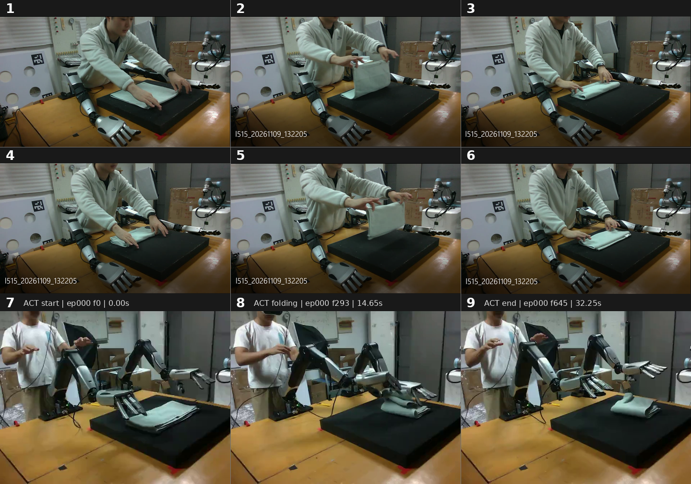

# 任务：对折并摆放毛巾，再交给双臂 ACT 继续折叠

先把毛巾的一条边折向对侧边，使两组对应角尽量对齐，形成双层长方形；随后保持折叠形状，将整条毛巾搬到黑色垫子中央。该摆放状态作为 ACT 的起始布料状态。放下、松手并撤离后，让左右机械臂分别回到本次冻结配置中各自的 `start_joint_positions`，设置左右手各自的 ACT 起始手型；确认双臂回位、双手手型反馈满足要求后，再调用双臂 ACT 完成后续折叠。



图 1～6 是人工双手示范，表达第一阶段的折叠关系与摆放顺序；图 7～9 是 `act_bimanual_default_run01` 实际训练数据中同一条双臂遥操作示范的三个观测帧，表达 ACT 阶段的起始状态、折叠过程和结束状态。机器人按本次配置允许的接口完成任务。

1. **图 1：确认初始状态，并抓住待折边。**示范中双手分别捻住同一条布边两端的相邻角（图像右下侧这条边），闭合后立即小幅抬升，确认布边随手提起。若某一边没有抓住，则单独处理该边，另一侧不动。
2. **图 2：提起并翻折。** 将抓住的边抬离垫面，向对侧边搬运，让毛巾沿中线弯折。并观察对齐的落点应当在哪里
3. **图 3：对齐并放下。** 将两个抓取角分别放到对侧对应角附近，尽量对齐两层边缘，再下降、松手，完成一次对折。
4. **图 4：抓住折好的毛巾的折边。** 在对折后在对折的那一边两端同时夹住上下两层。
5. **图 5：提起折好的毛巾。**轻提离开垫面，保持双层重叠，避免只提起上层而重新展开毛巾。
6. **图 6：搬到垫子中央，完成 ACT 前的布料准备。** 提起毛巾后尝试翻面，要求完成时毛巾保持对折、整体位于垫面中央，闭合折边与两层开口边的朝向均与图 7 一致。此时布料已基本摆到可以调用 ACT 的位置.
7. **图 7：双臂回位，准备交给 ACT。** 保持已经摆好的毛巾不动，从冻结配置中读取 `arms.left.start_joint_positions` 和 `arms.right.start_joint_positions`，分别用 `robo.move_J(left_start_joints, arm="left")` 和 `robo.move_J(right_start_joints, arm="right")` 回位。每侧都检查返回结果 `.reached`，两侧均到位后才开始 ACT；任一侧失败时停止后续动作并检查原因。使用各侧自己的记录值，不能复制另一侧关节角。这里传入的是七轴 rad 数组，不是 `initial_grasp_tcp`，也不是 `top_down_pose` 的参考朝向。图 7 主要用于观察 ACT 起始布料和双手的相对位置，精确回位目标以冻结配置为准。
8. **图 8：设置 ACT 起始手型，再调用双臂 ACT。** 双臂回位后保持毛巾不动，设置下方训练首帧对应的左右手五指手型，并检查各手 16 个有效位置槽位的最大反馈误差不超过 10 raw。双手手型确认后，调用 `robo.run_act(policy="fold")`，按当前接口默认的固定步数执行。机械臂回位不会同时改变手型，放布后的张开手型不能直接当作 ACT 起始手型。ACT 接管双臂及两只灵巧手；本次调用结束前，不额外发送普通 J/L 或 gripper 动作。图 8 是训练示范的中间状态，不是要求 agent 单独规划的抓取点或中间 TCP 目标。
9. **图 9：观察 ACT 执行结果。** 调用返回后，先检查 `status`、`steps_executed`、`hold_confirmed` 和 `reason`，再 `observe()` / `show()`，根据新图像判断毛巾是否完成后续折叠、是否保持叠放并留在垫面内。`completed` 只表示固定步数执行结束并确认保持，不直接表示折布成功；失败或未完成时如实报告现场，不盲目重放 ACT。

每次确认抓起后，正常搬运至放下前无需分段观察；仍逐段检查运动到位，异常时按需重新观察。第一阶段的放置与撤离完成后观察一次，ACT 返回后再观察一次。第一阶段完成后，应继续完成双臂回位与 ACT 阶段，再根据最终可见证据结束任务。

回位时直接使用公开 `move_J` 的 7 元关节数组形式，不调用启动专用入口、不重放 cell 000。
以下 `left_start_joints` 和 `right_start_joints` 须先按本次启动 prompt 的冻结配置分别赋值；
worker 没有配置文件读取入口，不访问 robo 的私有属性。

ACT 起始手型沿用 `scripts/act_start_cell.py` 的 `TRAINING_START_HANDS`，来源是
`act_bimanual_default_run01` 实际训练集的 **episode 36、frame 0**；该帧左右臂关节
与当前 `start_joint_positions` 一致，左右手取自同一条示范，不将统计中位数拼成手型。
这组手型来源与图 7～9 的 episode 0 不同，图像仍用于说明动作阶段。
下方数组均为 0～255 的位置 raw 值，不是角度；顺序对应手部 20 槽位中的
`[0,1,2,3,4,5,6,7,8,9,10,15,16,17,18,19]`，保留位 11～14 沿用实测值。
设置手型时按当前 `act.hand_max_raw_step` 渐进发送，完成后检查全部 16 个有效槽位。

当前公开 robo 尚无设置这组五指手型的接口；起始手型需由宿主准备，下面的 agent
示例负责检查反馈。`open_gripper`、`close_gripper`、`gripper_replay_start` 只控制
拇指/食指，不能替代这组五指手型。独立检查脚本已包含设置与确认手型的实现，
但不能在 agent 控制会话中另行启动它连接同一套设备；未准备好时在检查处停止并报告。

```python
act_start_hand_raw16 = {
    "left": [3, 122, 158, 150, 130, 244, 253, 171, 126, 12, 253, 176, 224, 208, 214, 231],
    "right": [58, 112, 146, 139, 100, 226, 254, 160, 95, 1, 254, 173, 230, 222, 232, 246],
}
active_hand_slots = list(range(11)) + list(range(15, 20))
left_home = robo.move_J(left_start_joints, arm="left")
if not left_home.reached:
    raise RuntimeError(f"左臂回位失败：{left_home.reason}")
right_home = robo.move_J(right_start_joints, arm="right")
if not right_home.reached:
    raise RuntimeError(f"右臂回位失败：{right_home.reason}")
state = robo.state()
for side in ("left", "right"):
    raw = state["arms"][side]["hand"]["position_raw"]
    if raw is None:
        raise RuntimeError(f"{side} 手部反馈不可用，暂不调用 ACT")
    actual = np.asarray(raw)[active_hand_slots]
    max_error = float(np.max(np.abs(actual - act_start_hand_raw16[side])))
    if max_error > 10:
        raise RuntimeError(f"{side} ACT 起始手型尚未准备好，最大误差 {max_error} raw")
act_result = robo.run_act(policy="fold")
print(act_result)
obs = robo.observe()
robo.show(obs)
```